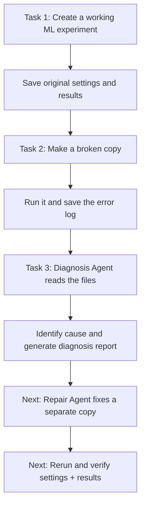

# RE:SOURCE AI

**An AI-agent project for recovering broken machine-learning experiments without losing their original scientific settings.**

This README summarizes our first three development tasks and what we plan to build next. The current prototype is a **rule-based Diagnosis Agent**; automatic repair and AI-model-driven diagnosis have not been implemented yet.

## Project flowchart



## What we completed

| Task | What we did | Result |
| --- | --- | --- |
| **1. Working experiment** | Trained a Random Forest classifier on the Iris dataset. Used an 80/20 train-test split and saved the model settings, software versions, and evaluation results. | A reference experiment; **96.67% accuracy** in our test run. |
| **2. Broken experiment** | Created a separate copy and intentionally changed the valid parameter `n_estimators` to `n_estimator`. Ran the broken script and captured its error log. | A repeatable `TypeError` for the agent to investigate. |
| **3. Diagnosis Agent** | Built a read-only Python tool that examines the traceback, broken code, Scikit-learn parameters, and saved reference settings. | Correctly identified the wrong parameter and generated a JSON diagnosis report without changing the input files. |

### Example from Task 3

**Error found:**

```text
TypeError: unexpected keyword argument 'n_estimator'
```

**Diagnosis:** The broken script uses `n_estimator`, but `RandomForestClassifier` expects `n_estimators`.

**Suggested fix:** Remove the incorrect parameter rename and retain the original setting of `n_estimators=100`.

The Diagnosis Agent **only suggested** this fix. It did not edit the file or rerun a repaired experiment.

## How the three tasks connect

- **Task 1 gives us the correct reference.** We need original settings and results to check later repairs.
- **Task 2 gives us a controlled failure.** We know what was broken, so we can test our system fairly.
- **Task 3 gives us the first diagnosis component.** It finds the cause and records evidence, rather than guessing or changing the experiment.

## What we will do next

**Task 4 — Repair Agent:** Apply an approved fix to a *copy* of the broken script, then rerun it. Keep the original reference untouched.

**Task 5 — Scientific verification:** Compare the repaired experiment with Task 1. Check the dataset, preprocessing, train-test split, model parameters, and evaluation results.

**Task 6 — Research tests:** Try additional errors and compare a basic repair workflow against one with scientific verification. Later, expand from Random Forest to ANN, CNN, and RNN/LSTM experiments.

## Research questions

**Gap 1 — Execution vs. reproducibility:** Does the repaired experiment reproduce the original results, not just run successfully?

**Gap 3 — Methodology preservation:** Did the repair keep the original scientific settings intact?

**Current status:** Tasks 1–3 are complete as a controlled prototype. Neither research gap has been experimentally validated yet, because we have not repaired and rerun a broken experiment.

## Project files

| File | Purpose |
| --- | --- |
| `RE_SOURCE_AI_Day1_Colab.ipynb` | Task 1: working baseline |
| `RE_SOURCE_AI_Day1_Task2_Broken_Experiment.ipynb` | Task 2: controlled failure |
| `RE_SOURCE_AI_Task3_Diagnosis_Agent_Colab.ipynb` | Task 3: guided diagnosis in Google Colab |
| `RE_SOURCE_AI_Task3_Diagnosis_Agent.py` | Standalone Python diagnosis tool |
| `RE_SOURCE_AI_Task3_Example_Diagnosis.json` | Example diagnosis output |

**Platform:** Python, Scikit-learn, and Google Colab (CPU). No GPU or paid API is required for Tasks 1–3.
